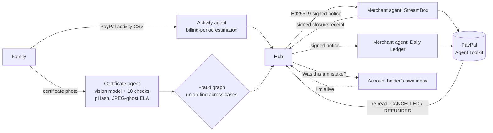

# Afterword

**When someone dies, their subscriptions don't.**

Afterword lets a grieving family tell every company once. It reads the death certificate in any language, finds everything still charging the person's PayPal account, and sends each company one signed, verified notice. Each company's own agent checks the notice against its PayPal records, **pauses billing at once**, then cancels and refunds what was taken after the death. A person approves, or the company's written auto-close rule does.

Before anything irreversible happens, Afterword writes to the account holder's own address: *"Was this a mistake?"*. One click from a living person rolls everything back.

Built for the PayPal AI Hackathon 2026 with the **PayPal Agent Toolkit (Python)**, **Gemini**, **AG Studio + AG Grid**, **Bryntum Scheduler** and **Render**.

---

## Judges: 3 minutes, no keys

```bash
git clone https://github.com/Haresh276/afterword && cd afterword
python scripts/start_demo.py          # installs what's missing, opens http://localhost:8000
```

| Minute | Where | What to try |
|---|---|---|
| 0:00 | **For families** | *Fill in the demo family* → *Continue* → *Use the demo specimen*. Ten checks run on a fictional certificate stamped SPECIMEN, then the image is deleted. Open *How we checked the image*. |
| 0:30 | Step 3 | *Use the demo export*. It finds 8 things still charging the account, $63.93 already taken after the death and $946.96 a year if nothing is done. The **Bryntum timeline** shows every charge before and after the death. |
| 1:00 | Step 4 | *Tell 7 companies*. Billing is **paused** everywhere within seconds. A countdown shows the objection window (30 seconds in the demo, 72 hours in production). Open *See the email* to read what the account holder's own inbox received. Then wait: six companies cancel, refund, sign a receipt, and Afterword re-reads PayPal to confirm. The timeline turns green, and the year of charges that won't be taken fades out. |
| 1:45 | **For businesses → The Daily Ledger** | A human-review merchant. Open the notice: PayPal's subscriber record is matched to the certificate, and each step is labelled reversible or irreversible. *Approve all*: the pause runs now, and the rest is scheduled for when the window ends. |
| 2:15 | **For businesses → Network insights** | The **AG Studio** report covers network, PayPal steps and safety. Press *Edit this report* to drag in your own widgets. |
| 2:40 | **Try to break it** | *Run every attack*. Nine live attacks against the real code: forged certificate, prompt injection, notice tampering, payload swap, over-refund, double refund, expired approval, agent paying without approval, audit-log rewrite. **9 of 9 blocked.** |
| Bonus | Step 4 again | *Start the demo again*, send, then open the email link as the account holder and press *I'm alive. Stop this.* Every pause is resumed, nothing is cancelled, no money moves, and the reporter is flagged. |

No keys needed. Without keys it runs on a built-in emulator of the PayPal endpoints and an offline reader for the bundled specimen. The header shows which mode is on. With `PAYPAL_CLIENT_ID`/`SECRET` set, every call goes to the real PayPal sandbox.

---

## Why

- Bereaved UK families spend about **7 million hours a year** closing a dead person's subscriptions and accounts, which the research values at **£171m**. The average person has **11.47** accounts and services to close ([Life Ledger research](https://funeralservicetimes.co.uk/news/people/2021/01/14/bereaved-families-lose-171m-a-year-cancelling-subscriptions)).
- **22 of 49** UK savings providers had no online way to report a death ([Fairer Finance](https://www.fairerfinance.com/insights/press-releases/financial-services-firms-continuing-to-charge-customers-after-they-die)).
- The UK Death Notification Service and Tell Us Once cover banks and government, not the subscription economy. PayPal's own deceased-account process closes the PayPal account, but doesn't stop recurring payments to merchants.
- The other side of the risk: about **12,000 living Americans are wrongly declared dead each year** ([Smithsonian, citing SSA](https://www.smithsonianmag.com/smart-news/about-12200-people-are-erroneously-declared-dead-every-year-us-government-180955549/)). Any "tell everyone someone died" product can be abused to grief a living person. Afterword is designed around that.

## How it works



| # | Who | What happens |
|---|---|---|
| 1 | Family | A vision model reads the certificate in any language. **The image is never stored**: only the fields, a SHA-256 and a perceptual hash are kept. |
| 2 | Code | Ten checks, five of them blocking: document type, impossible dates, an edited image (JPEG-ghost ELA), the network (same certificate or registration used for someone else), and **payments the person made themselves after the date of death**. |
| 3 | Family | The PayPal activity export is parsed with per-file date-order detection (Indian exports use DD/MM). Robust period estimation finds subscriptions, annual renewals, saved billing agreements and open invoices. One-off purchases and payments to family are left alone, with a stated reason. |
| 4 | Hub | Signs one notice per company (`afterword/notice@1`, Ed25519). It carries only the name, PayPal email, date of death, payment references, verification result and the objection deadline. **Not the certificate.** |
| 5 | Hub | Writes to the deceased's own address, in wording that won't alarm a family member reading it. |
| 6 | Merchant agent | Verifies the signature, matches `show_subscription_details` to the certificate and lists transactions after the death. It proposes **pause now** (reversible), then **cancel**, **refund each post-death capture** and **cancel open invoices** (irreversible, gated on the window). |
| 7 | Person or rule | Approves. Auto-close only applies when every check passes and refunds are under the merchant's cap. |
| 8 | Merchant | Signs a closure receipt with its own key. Turns off every email to the deceased. |
| 9 | Hub | Doesn't take the merchant's word for it: it **re-reads PayPal** to confirm `CANCELLED` / `REFUNDED`. |
| 10 | Family | Gets one letter in their language (English, Hindi, Tamil, Telugu), emails ready for companies not on Afterword, a PDF record, and a filled-in cover sheet for PayPal's own deceased-account process. |

## The trust layer

Afterword's AI reads documents and writes letters. **No language model sits in the money path.** Amounts and targets come from code reading PayPal, and every money-moving call goes through one choke point (`backend/app/paypal_gateway.py`):

| Guarantee | How |
|---|---|
| Nothing irreversible before the objection window | Each action has `not_before`. The gateway refuses earlier calls with `WindowOpen`; it isn't left to the UI. |
| No money moves without approval | `cancel`, `pause`, `resume`, `refund` and `cancel invoice` all raise without an approved action id. |
| An approval can't be repurposed | It's bound to a SHA-256 of the exact payload and expires after 24 hours. |
| Exactly once | Every call carries `PayPal-Request-Id`, so a retry returns the same refund. |
| Refunds can't be redirected | They go back to the original capture only. Nothing is ever paid to the person reporting. |
| A living person can stop it | The objection link withdraws every notice with a signed withdrawal, resumes paused billing, rejects pending steps, and flags the reporter and the person in the fraud graph. |
| A fraudster can't lock out the real family | A reuse flag is critical only if the other case *passed*. A blocked forgery becomes an informational note on the genuine case. |
| Tamper-evident | The audit log is append-only (SQLite triggers) and SHA-256 hash-chained, with a *Verify the chain* button. |

**Try to break it** runs nine attacks against these guarantees live, in the UI. They are also in the test suite (`backend/tests`, **24 tests**).

## Techniques

| Problem | Technique |
|---|---|
| A re-saved copy of a real certificate | 64-bit DCT **perceptual hash**, with Hamming distance ≤ 10 counting as the same document |
| A name typed onto a photo of a certificate | **JPEG-ghost error-level analysis** (after Farid, 2009). It sweeps re-compression quality on luminance and compares only text blocks, with robust median/MAD z-scores. Only a 16×12 score grid is kept. |
| One fake death used at several companies | **Fraud graph**: union-find over certificate hashes, registration numbers, person and claimant. It flags velocity (3 deaths in 30 days), and links sibling duplicates rather than blocking them. |
| Recurring vs one-off, with price rises | **Median inter-arrival period** snapped to canonical billing cycles, with MAD confidence and ±25% amount drift allowed when the timing is regular |
| What happens if nobody acts | **Next-charge prediction** per subscription, including annual renewals, giving the cost per year |
| "Trust me, we cancelled it" | **Two-way signatures**: the hub signs notices, merchants sign receipts, and the hub re-reads PayPal |

Limits, stated plainly:
- Error-level analysis misses edits on very high-quality originals (above about JPEG 90) and can't analyse lossless images. It's one signal of several.
- In the demo, all merchants share one database and one sandbox account. In production, each keeps its own keys and records.

## PayPal

| Capability | Via | Used for |
|---|---|---|
| `show_subscription_details` | Agent Toolkit | Match the subscriber's name and email to the certificate |
| `cancel_subscription` | Agent Toolkit | Stop future charges, after the window |
| `get_invoice`, `cancel_sent_invoice`, `send_invoice` | Agent Toolkit | Open invoices addressed to the deceased |
| `create_product`, `create_subscription_plan`, `create_subscription` | Agent Toolkit | Building the sandbox demo (`backend/scripts/sandbox_setup.py`) |
| `POST /v1/billing/subscriptions/{id}/suspend` and `/activate` | Toolkit's authenticated client | Reversible pause, and resume if the person objects |
| `GET /v1/billing/subscriptions/{id}/transactions` | Toolkit's authenticated client | Captures after the date of death |
| `POST /v2/payments/captures/{id}/refund` + `PayPal-Request-Id` | Toolkit's authenticated client | Refund each post-death charge exactly once |
| `POST /v1/notifications/verify-webhook-signature` | REST | Trust `BILLING.SUBSCRIPTION.CANCELLED` / `PAYMENT.CAPTURE.REFUNDED` webhooks only when PayPal vouches for them |

## AI

| Where | Model's job | Code's job |
|---|---|---|
| Certificate | Read any language and layout, transliterate names, note visible alterations | Ten checks; five blocking |
| Letters | Kind, specific letters in the family's language | Facts and amounts passed in; the model can't change them |
| AG Studio assistant | AG Studio's own agent explains and builds charts | `/api/ai/responses` is an **OpenAI Responses-API shim over Gemini**, so AG's documented adapter runs unchanged with no OpenAI key |
| Merchants' own agents | Read and verify notices over **MCP** at `/mcp` (`list_notices`, `get_notice`, `verify_notice`) | Read-only: no MCP tool can move money |

## Sponsor tools

- **AG Studio**: *For businesses → Network insights*. A three-page report (network, PayPal steps, safety) over live hub data plus a seeded 90-day simulation, every row labelled `Live` or `Simulated`. Page tabs, in-place edit mode and the AI assistant. **AG Grid** runs the merchant inbox.
- **Bryntum Scheduler**: the family's timeline. One row per company: charges before and after the death, *told* and *closed* markers, the objection window, and the next year of charges that won't be taken.
- **Render**: one-click Blueprint (`render.yaml`, Docker, free plan, health check `/api/status`).

## Run it yourself

```bash
python scripts/start_demo.py                 # everything, offline
# or by hand
cd backend && pip install -r requirements.txt && uvicorn app.main:app --port 8000
cd frontend && npm install && npm run build  # the API serves frontend/dist
docker build -t afterword . && docker run -p 8000:8000 --env-file .env afterword
```

Environment (all optional):

| Variable | Effect |
|---|---|
| `GEMINI_API_KEY` or `OPENAI_API_KEY` | Live certificate reading, letters, AG Studio assistant |
| `PAYPAL_CLIENT_ID`, `PAYPAL_CLIENT_SECRET`, `DEMO_CLIENT_EMAIL` | Real PayPal sandbox instead of the emulator |
| `AFTERWORD_OBJECTION_WINDOW` | Seconds before irreversible steps may run (demo default 30; production 259200) |
| `PAYPAL_WEBHOOK_ID` | Turns on verified webhooks |

**Real sandbox.** Create a Personal sandbox account named exactly *Lakshmi Narayanan* and set the variables above. Run `python backend/scripts/sandbox_setup.py create`, approve each link as that buyer, run `finish`, then restart.

**Tests.** `cd backend && python -m pytest -q`

## What's next

- Vault payment-token removal in the same notice.
- PayPal's own deceased-account team as an Afterword node.
- An executor role across estates.
- Banks and utilities through the same signed notice.

## Team

- **Haresh G.** (SRM University AP): product, AI agents, pitch
- **\<Senior's name\>** (SRM University AP, CSE): frontend, deployment

MIT licensed. Every person, company and document in the demo is fictional.
